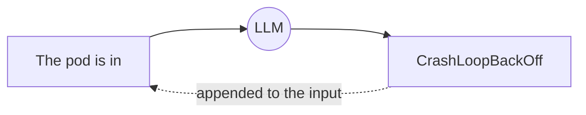

# 1 · How large language models work

You don't need to train models to be an AI engineer, but you do need an accurate mental model of what they are. Most bugs in AI applications come from expecting a model to behave like a database or a deterministic function.

## A model predicts the next token

A large language model (LLM) is a neural network trained on a huge amount of text to do one thing: **given some text, predict what comes next.** It generates an answer one piece at a time, adding each predicted piece to the input and predicting again.

Those pieces are **tokens**: chunks of text, usually a word or part of a word. "Kubernetes" might be two or three tokens; a space plus a common word is often one. As a rough rule, 1 token ≈ ¾ of an English word.

Tokens matter because **everything is counted and billed in tokens**: what you send (input tokens) and what the model writes (output tokens).

## Transformers and attention, in one paragraph

Modern LLMs are **transformers** (from the 2017 paper *Attention Is All You Need*). Their key idea is **attention**: when predicting the next token, the model looks back at every earlier token and learns how much each one matters. In "the payment-service pool is exhausted, so **it** times out", attention is how the model links "it" to "payment-service". Stacking many attention layers lets the model capture grammar, facts, reasoning patterns and code structure.

After pre-training on raw text, models are further trained to follow instructions and to be helpful and safe (instruction tuning and reinforcement learning from human feedback). That is why a model answers your question instead of just continuing your text.

## The context window

The **context window** is the maximum number of tokens the model can consider at once: your instructions, the conversation so far, tool results, documents, and its own answer. Modern models have windows of hundreds of thousands of tokens or more, but:

- **The model has no memory between calls.** Every request must include everything it needs. A "chat" is your code resending the whole conversation each time ([project 07](../07-cloud-cost-agent/) and [09](../09-runbook-agent/) do exactly this).
- **More context costs more and is slower.** Sending a 2 GB log file is impossible, and sending 100 pages "just in case" is expensive. That's why [project 04](../04-log-analyser-agent/) gives the model search tools instead of the whole file, and why RAG exists ([concept 4](04-embeddings-and-rag.md)).

## Why models are not deterministic

At each step the model produces a probability for every possible next token, then **samples** one. **Temperature** controls how adventurous that sampling is: low temperature picks the most likely tokens (more consistent), high temperature picks less likely ones (more varied).

Consequences for engineers:
- The same prompt can give different answers. **Test with many cases and repeated runs**, not one ([concept 7](07-evals.md)).
- Never parse free text if you can get **structured output** ([concept 2](02-prompting-and-structured-output.md)).

## Hallucination

A model generates *plausible* text, not *verified* text. When it doesn't know something, it may produce a confident, fluent, wrong answer: a **hallucination**. It's not lying; it's predicting what an answer would look like.

The engineering fixes:

| Problem | Fix | Project |
|---|---|---|
| Model guesses numbers | Give it a tool that calculates | [01](../01-first-agent-calculator/), [07](../07-cloud-cost-agent/) |
| Model doesn't know your company's facts | Give it the documents (RAG) and require citations | [08](../08-chat-with-docs-rag/) |
| Model invents a plausible root cause | Give it tools to look at real evidence | [04](../04-log-analyser-agent/), [05](../05-kubernetes-helper-agent/) |
| You can't tell how often it's wrong | Evals | [13](../13-evals/) |

## Choosing a model

Models come in tiers: larger ones reason better and cost more; smaller ones are faster and cheaper. A common pattern is a small model for simple, high-volume steps (classification, routing) and a large model for hard reasoning. You can also run **open-weight models** (Llama, Mistral, Qwen, Gemma) on your own GPUs, which is an LLMOps job ([concept 9](09-llmops.md)).

## Key terms

- **Token:** the unit of text a model reads and writes, and the unit of cost.
- **Context window:** how many tokens fit in one request, input plus output.
- **Temperature:** randomness of sampling.
- **Pre-training / fine-tuning:** learning from raw text / further training on specific examples.
- **Hallucination:** fluent output that isn't true.
- **Inference:** running a trained model to get an answer (what an API call does).

## Further reading

- Jay Alammar, *The Illustrated Transformer* (visual explanation of attention)
- 3Blue1Brown, *Neural networks* video series, chapters on transformers and attention
- Andrej Karpathy, *Neural Networks: Zero to Hero* and *Intro to Large Language Models* (YouTube)
- Vaswani et al., *Attention Is All You Need* (2017): the original transformer paper
