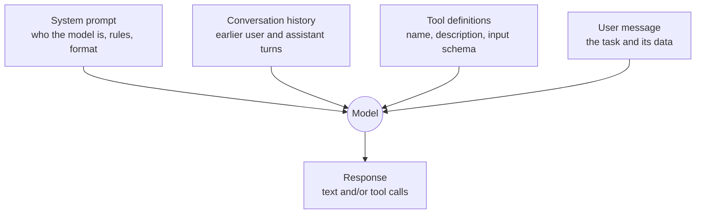

# 2 · Prompting and structured output

A prompt is the program you write for a model. It's less precise than code, but the same habits apply: be explicit, give examples, define the output format, and test it.

## The parts of a request



- **System prompt:** standing instructions (role, rules, tone, what to do when unsure). Every project here sets one, called `SYSTEM`.
- **Messages:** alternating `user` and `assistant` turns. The model sees all of them on every call.
- **Tools:** functions the model may ask you to run ([concept 3](03-tool-calling-and-agents.md)).

## What makes a good prompt

1. **Be specific about the task and the audience.** "Explain the cause in plain English for an on-call engineer" beats "analyse this".
2. **Give the model a method.** [Project 04](../04-log-analyser-agent/) tells it to look at what happened *before* the first error; without that line, models often stop at the symptom.
3. **Give a checklist for reviews.** [Project 06](../06-config-reviewer-agent/) lists what a production review must check. Try deleting it and comparing scores.
4. **Say what to do when unsure.** "If the sources don't contain the answer, say you don't know" ([project 08](../08-chat-with-docs-rag/)) cuts hallucinations sharply.
5. **Show examples (few-shot).** One or two worked examples of input and ideal output teach format and style better than a paragraph describing them.
6. **Put data in clearly marked sections**, e.g. `Sources:` … `Question:` …, so the model doesn't confuse your instructions with the data.

**Tool descriptions are prompts too.** The model decides whether and how to call a tool from its name and description alone. A vague description gives a tool that's used wrongly or not at all.

## Structured output

Code can't reliably parse "Sure! Here's the report: …". When the output feeds another system (a ticket, a database, a dashboard), you need **JSON that matches a schema**.

Three approaches, from weakest to strongest:

| Approach | How | Reliability |
|---|---|---|
| Ask nicely | "Reply in JSON with fields …" | Often works; sometimes adds prose or breaks the format |
| Forced tool call | Define a tool whose input schema *is* your output format, and force the model to call it | Very reliable; used in this repo (`agentkit.extract`) |
| Native structured output | Provider or framework feature, e.g. LangChain's `with_structured_output(MyPydanticModel)` | Very reliable; used in [project 11](../11-langgraph-incident-assistant/) |

```python
# The forced-tool trick (see src/agentkit/agent.py, extract())
client.messages.create(
    model=MODEL,
    max_tokens=1024,
    tools=[{"name": "incident_report", "description": "File the report", "input_schema": SCHEMA}],
    tool_choice={"type": "tool", "name": "incident_report"},   # must answer through this tool
    messages=[{"role": "user", "content": task}],
)
```

Use `enum` for fixed choices (`"severity": {"enum": ["low", "high"]}`) and mark fields `required`. Validate the result in code anyway.

## Common mistakes

- Packing every rule into one giant prompt. Split the work into steps or tools instead.
- Changing a prompt and judging it on one example. Prompts need evals ([concept 7](07-evals.md)).
- Trusting instructions inside the *data* (a document, a web page, a log line). That's prompt injection ([concept 8](08-agent-safety.md)).

## Further reading

- Anthropic, *Prompt engineering overview* (docs.anthropic.com) and the free interactive prompt engineering tutorial on GitHub
- Google, *Prompting strategies* in the Gemini API docs
