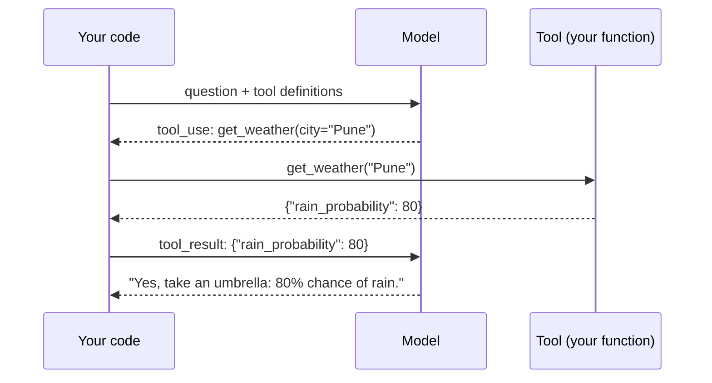

# 3 · Tool calling and agents

A model on its own can only produce text. **Tool calling** lets it ask your code to do things: look up data, run a calculation, call an API. An **agent** is a model using tools in a loop until a task is done.

## How tool calling works

You describe your functions to the model (name, description, JSON schema of arguments). The model never runs anything itself. It replies with a **request**: "call `get_weather` with `{"city": "Pune"}`". Your code runs the function and sends back the result. The model then answers, or asks for another tool.



This is **the agent loop**, and you write it by hand in [project 01](../01-first-agent-calculator/agent.py). Every framework (LangGraph, Google ADK, the Claude Agent SDK, OpenAI's Agents SDK) is this loop with extra features around it.

```python
while True:
    response = model(messages, tools)
    if response.stop_reason != "tool_use":
        return response.text                    # done: the model answered
    for call in response.tool_calls:
        result = run(call.name, call.input)     # YOUR code runs the tool
        messages.append(tool_result(call.id, result))
```

Key points:
- **The model chooses** which tool to call, with what arguments, and when to stop.
- **It can call several tools in one turn**, e.g. weather for two cities at once.
- **Errors are information.** Send the error message back as the tool result (with `is_error`); good models recover by trying something else. See `run_agent` in [`src/agentkit/agent.py`](../src/agentkit/agent.py).
- **Cap the loop** (`max_turns`) so a confused agent can't run forever and run up a bill.

## Workflows versus agents

Not everything needs an agent. Anthropic's guide *Building effective agents* draws a useful line:

| | Workflow | Agent |
|---|---|---|
| Who decides the steps | Your code | The model |
| Predictability | High | Lower |
| Good for | Known, repeatable processes | Open-ended problems where the path isn't known in advance |
| In this repo | [06](../06-config-reviewer-agent/) (one call), [11](../11-langgraph-incident-assistant/) (a fixed graph) | [04](../04-log-analyser-agent/), [05](../05-kubernetes-helper-agent/), [09](../09-runbook-agent/) |

Start with the simplest thing that works: one model call, then a fixed workflow, and only then a free agent.

Common workflow patterns:
- **Prompt chaining:** step 1's output is step 2's input (project 04: investigate, then extract a report).
- **Routing:** classify first, then send to a specialist (project 11's severity edge; project 12's root agent).
- **Parallelisation:** run independent checks at the same time.
- **Orchestrator–workers:** one model splits a task and delegates parts (multi-agent, [concept 6](06-agent-frameworks.md)).
- **Evaluator–optimiser:** one call produces, another critiques, repeat.

## Memory

Models are stateless ([concept 1](01-how-llms-work.md)). What looks like memory is engineering:

- **Short-term memory:** keep the message history and resend it ([projects 07, 09](../09-runbook-agent/): `agentkit.chat`).
- **Long-term memory:** store facts outside the model (a database or vector store) and retrieve the relevant ones into the prompt, which is RAG again ([concept 4](04-embeddings-and-rag.md)).
- **State in a graph:** frameworks like LangGraph keep a typed state object and can checkpoint it to resume later.

Long conversations grow expensive; real systems summarise or trim old turns.

## Designing good tools

Tools are an API whose user is a model. Make them:
- **Clearly named and described**, including when to use them and the argument format, with examples.
- **Small and focused:** `search_log(pattern)` and `read_lines(start, end)` beat a single `do_log_stuff(action, ...)`.
- **Bounded:** truncate output, page through results (project 04 caps lines at 100).
- **Safe by construction:** read-only where possible, allow-lists, sandboxed paths, dry runs ([concept 8](08-agent-safety.md)).
- **Returning facts, not prose:** JSON the model can reason over.

## Further reading

- Anthropic, *Building effective agents* (anthropic.com/engineering)
- Anthropic docs, *Tool use* (docs.anthropic.com)
- Google, *Function calling* in the Gemini API docs
