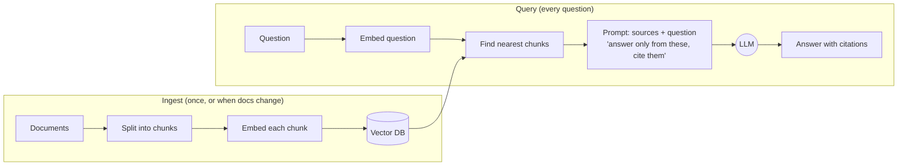

# 4 · Embeddings and RAG

Models don't know your company's runbooks, contracts or code, and you can't paste everything into every prompt. **Retrieval-augmented generation (RAG)** solves this: find the few pieces of your documents relevant to a question, and give the model only those.

## Embeddings: meaning as numbers

An **embedding model** turns a piece of text into a list of numbers (a **vector**, typically a few hundred to a few thousand numbers). Texts with similar *meaning* get vectors that point in similar directions, even with no words in common:

- "pod keeps restarting" and "container in CrashLoopBackOff" → close together
- "pod keeps restarting" and "quarterly cloud invoice" → far apart

Closeness is measured with **cosine similarity** (the angle between two vectors) or a **distance** (smaller means closer). This is the vector maths from the learning path's phase 1, in practice.

A **vector database** (Chroma, pgvector in Postgres, Qdrant, Pinecone, OpenSearch) stores the vectors and quickly finds the nearest ones to a query vector.

## The RAG pipeline

All of it is in [`08-chat-with-docs-rag/rag.py`](../08-chat-with-docs-rag/rag.py), about 100 lines.

## The decisions that matter

**Chunking.** Documents are split before embedding because one vector can't represent a 50-page PDF well, and you want to retrieve only the relevant part.
- Too small: chunks lose context ("cancel it with …" — cancel *what*?).
- Too large: retrieval gets fuzzy, prompts get long and expensive.
- Split on natural boundaries (paragraphs, headings) and **overlap** neighbouring chunks a little so an answer spanning a boundary isn't lost. Project 08 packs paragraphs up to 800 characters with one paragraph of overlap.

**How many chunks (k).** More chunks raise the chance the answer is included, but add noise and cost. 3–8 is a common range; measure it ([concept 7](07-evals.md)).

**Grounding and citations.** Tell the model to answer *only* from the sources, cite them, and say "I don't know" otherwise. Citations let users check the answer, and let you debug it.

**Metadata.** Store the source file, section, date and access level with each chunk, so you can filter ("only runbooks for the payments team") and cite.

## When RAG answers are wrong

Always ask: **was retrieval wrong, or was generation wrong?** Print the retrieved chunks (`ask.py --show-chunks`).

| Symptom | Likely cause | Fix |
|---|---|---|
| Right answer isn't in the retrieved chunks | Retrieval | Better chunking, more `k`, hybrid search, query rewriting |
| Right chunk retrieved, answer still wrong | Generation | Better prompt, stronger model, fewer noisy chunks |
| Answer includes facts not in any chunk | Hallucination | Stricter grounding instruction, a judge check |

## Beyond basic RAG

- **Hybrid search:** combine vector search with keyword search (BM25). Keywords catch exact terms like error codes (`pg_cancel_backend`, `137`) that embeddings can blur.
- **Re-ranking:** fetch 20 candidates cheaply, then use a re-ranking model (or an LLM) to pick the best 5.
- **Query rewriting:** have the model rewrite a vague question into a better search query first.
- **Agentic RAG:** give retrieval to an agent as a tool, so it can search several times ([project 09](../09-runbook-agent/)).
- **Access control:** a RAG system must never retrieve documents the user isn't allowed to see. Filter by permissions *before* the model sees anything.

## RAG versus fine-tuning

| Need | Use |
|---|---|
| The model must know facts that change (docs, tickets, prices) | **RAG**: update the index, no retraining |
| The model must cite sources | **RAG** |
| A consistent style, format or narrow skill, at scale | **Fine-tuning** may help |
| Most company use cases | Start with RAG and good prompts |

## Further reading

- Chroma docs (docs.trychroma.com) and the pgvector README (github.com/pgvector/pgvector)
- Anthropic, *Contextual retrieval* (anthropic.com/news), on improving chunk retrieval
- DeepLearning.AI short courses on RAG and vector databases
