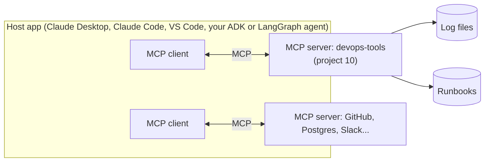

# 5 · MCP: the Model Context Protocol

Before MCP, every AI app had its own way of defining tools. A tool written for one framework had to be rewritten for the next. **MCP** is an open protocol, started by Anthropic in 2024 and now widely adopted, that standardises how AI applications connect to tools and data. A common comparison: **USB-C for AI apps.**

## The pieces

- **Host:** the AI application the user works in.
- **Client:** the part of the host that speaks MCP to one server.
- **Server:** a small program exposing capabilities. You write these. [Project 10](../10-mcp-server/server.py) is one.

## What a server can offer

| Primitive | Controlled by | Example in project 10 |
|---|---|---|
| **Tools** | the model decides when to call them | `log_summary`, `search_log` |
| **Resources** | the application or user chooses what to load | `runbook://disk-full` |
| **Prompts** | the user picks a ready-made template | (try adding one) |

Tools are like the function calls in [concept 3](03-tool-calling-and-agents.md); MCP just standardises how they're described and invoked. Under the hood, messages are JSON-RPC.

## Transports

- **stdio:** the host starts the server as a local process and talks over stdin/stdout. Simple, local, no network (project 10's default).
- **Streamable HTTP:** the server runs as a web service (for example in Kubernetes) that many clients reach over the network. Now you need what any API needs: authentication (MCP uses OAuth 2.1), TLS, rate limits, logging.

## Why it matters for an AI engineer

- **Write once, use everywhere:** the same server works in Claude Desktop, IDEs, Google ADK, LangGraph and others.
- **Separation of concerns:** platform teams publish governed MCP servers for internal systems; app teams consume them.
- **Security boundary:** the server decides what's possible. A read-only server stays read-only no matter what the model is told ([concept 8](08-agent-safety.md)). Treat third-party MCP servers like any dependency: read the code, pin versions, give them least-privilege credentials.

## Further reading

- modelcontextprotocol.io: specification, concepts and the list of SDKs
- The MCP Python SDK on GitHub (`modelcontextprotocol/python-sdk`), including its v1 → v2 migration guide
- MCP Inspector (`mcp dev server.py`) for testing a server by hand
