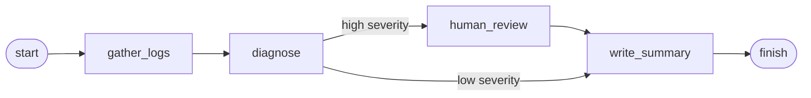
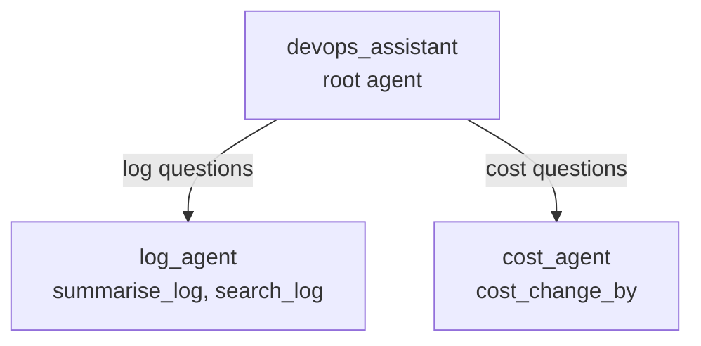

# 6 · Agent frameworks: LangGraph, Google ADK and others

A framework gives you the agent loop ([concept 3](03-tool-calling-and-agents.md)) plus what you'd otherwise build yourself: state, memory, multi-agent routing, streaming, human approval, tracing and deployment. Learn the loop by hand first ([project 01](../01-first-agent-calculator/)) so the framework is never magic.

## LangGraph: agents as graphs

LangGraph (from the LangChain team) models an application as a **graph**:

- **State:** a typed object (a `TypedDict` or Pydantic model) that flows through the graph.
- **Nodes:** functions that read the state and return updates. A node can call a model, call tools, or be plain Python.
- **Edges:** what runs next. **Conditional edges** choose the next node from the state.
- **Checkpointer:** saves state after each step, so a run can pause (for human approval) and resume later, even days later.

That's [project 11](../11-langgraph-incident-assistant/graph.py). LangGraph suits flows where **you** want control over the steps, with the model making decisions inside them. It also has a prebuilt ReAct-style agent for the free-loop case.

## Google ADK: agents and sub-agents

The Agent Development Kit (ADK) is Google's open-source framework. Its building blocks:

- **`Agent`** (an LLM agent): a model, an `instruction`, a `description`, and `tools`. Tools are plain Python functions; ADK builds their schema from type hints and the docstring.
- **Multi-agent:** give an agent `sub_agents`. A root agent reads each request and **transfers** to the right specialist, using the sub-agents' `description`s to decide ([project 12](../12-google-adk-agent/)).
- **Workflow agents:** `SequentialAgent`, `ParallelAgent` and `LoopAgent` run sub-agents in a fixed pattern, without the model deciding.
- **Developer tools:** `adk web` (a local UI showing every event, tool call and transfer), `adk run`, built-in evaluation, and `adk deploy` to Cloud Run or Vertex AI Agent Engine.
- It's Gemini-first but can use other models (including Claude) through LiteLLM, and can use MCP servers as tools.

## Others worth knowing

- **Claude Agent SDK:** Anthropic's framework, built on the same agent harness as Claude Code: tools, file and shell access, sub-agents, MCP, permissions.
- **OpenAI Agents SDK:** agents, hand-offs between agents, guardrails, tracing.
- **LlamaIndex:** strongest on data and RAG pipelines.
- **CrewAI, AutoGen:** multi-agent "teams" of roles.
- **Java:** **Spring AI** and **LangChain4j** bring the same ideas (chat clients, tools, RAG, MCP) to Spring Boot.

## How to choose

| If you need | Consider |
|---|---|
| To understand everything, or a small focused agent | The plain SDK loop (this repo's `agentkit`) |
| Explicit control flow, long-running flows, human approval with resume | **LangGraph** |
| Multi-agent systems, Google Cloud deployment, a built-in dev UI | **Google ADK** |
| An agent that works with files, shells and code, like Claude Code | Claude Agent SDK |
| AI inside an existing Spring Boot service | Spring AI / LangChain4j |

The concepts transfer. A node in LangGraph, a sub-agent in ADK and a function in your own loop are the same idea in different clothes.

## Multi-agent: when it's worth it

Splitting work across agents helps when sub-tasks need **different tools or instructions**, or would **overflow one context window**. But each hand-off adds latency, cost and room for error. Start with one agent and good tools; split only when one agent clearly struggles.

## Further reading

- LangGraph docs (langchain-ai.github.io/langgraph): quickstart, human-in-the-loop, persistence
- Google ADK docs (google.github.io/adk-docs): agents, multi-agent systems, tools, deploy
- Anthropic, *Building effective agents* (anthropic.com/engineering)
