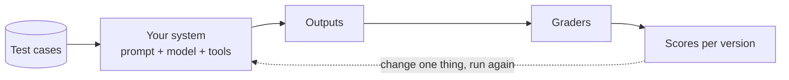

# 7 · Evals: measuring whether it works

In ordinary software, a function that passes its tests keeps passing. AI systems are different: outputs vary between runs ([concept 1](01-how-llms-work.md)), and a prompt change that fixes one case can quietly break three others. **Evals** are the AI equivalent of a test suite, and the skill that most separates AI engineers from people who build demos.

## What an eval is

1. A **dataset** of test cases: inputs, and what a good output must contain or do.
2. A way to **run** your system on every case.
3. **Graders** that score each output.
4. A **report** you can compare across versions.

## Kinds of graders

| Grader | How | Good for | Weakness |
|---|---|---|---|
| **Code checks** | exact match, contains, regex, valid JSON, schema | facts, formats, refusals | brittle with wording |
| **LLM-as-judge** | a second model grades the answer against a rubric and the sources | correctness, groundedness, tone | the judge can be wrong; check it against human grades |
| **Human review** | people score a sample | the ground truth | slow, expensive |
| **Task success** | did the agent reach the goal (ticket filed, test passes)? | agents | needs a test environment |

[Project 13](../13-evals/) uses three: retrieval (did search find the right runbook?), facts (code check), and an LLM judge. [Project 06](../06-config-reviewer-agent/) has a simpler keyword eval.

## What to measure for each kind of system

- **RAG:** retrieval hit rate; answer correctness; **groundedness** (no claims beyond the sources); correct "I don't know" on unanswerable questions.
- **Agents:** task success; number of steps and tool calls; wrong or unsafe tool calls; cost and time per task.
- **Structured output:** schema validity; field-level accuracy.
- **Everything:** latency and cost per request.

## The workflow

1. **Start small:** 20–50 cases, including edge cases and questions the system should refuse.
2. **Get a baseline** score.
3. **Change one thing** (prompt, model, chunk size, `k`, a tool description).
4. **Re-run and compare.** Keep the change only if scores improve without regressions.
5. **Grow the dataset from real failures:** every bug a user reports becomes a test case.
6. **Automate:** run evals in CI on every pull request that touches a prompt or model, and fail the build on a drop. The same discipline as unit tests.

## Common mistakes

- Judging a prompt change on one or two examples.
- Running each case once: run several times and look at the spread.
- Trusting an LLM judge without spot-checking it against your own judgement.
- Measuring only quality, not cost and latency.
- Test cases that leak into prompts or few-shot examples.

## Further reading

- Hamel Husain, *Your AI product needs evals* (hamel.dev)
- Anthropic docs, *Define success criteria* and *Create strong empirical evaluations*
- Google ADK docs, *Evaluate*; LangSmith and Langfuse docs on datasets and evaluators
